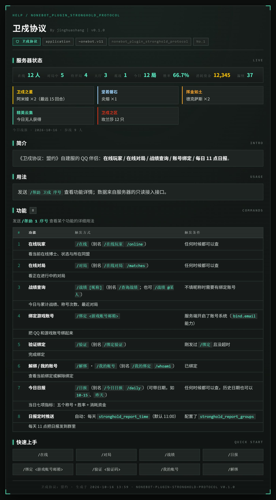
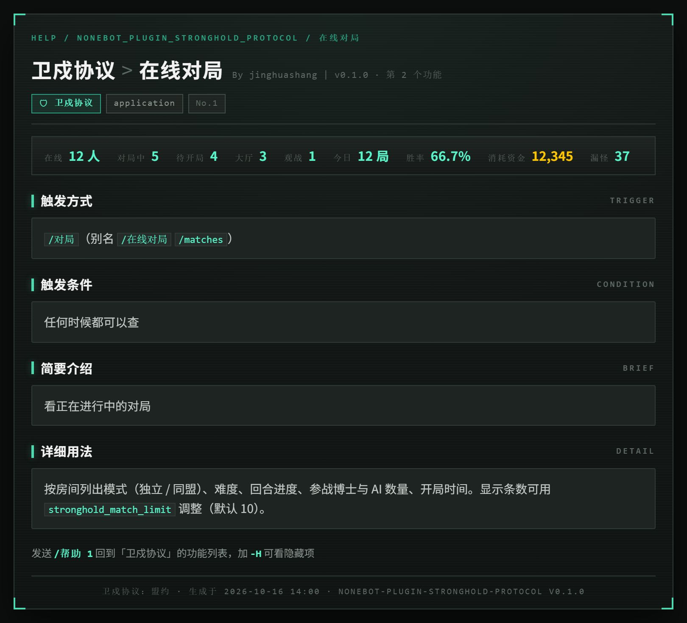

<!-- markdownlint-disable MD033 MD041 -->

<div align="center">
  <a href="https://v2.nonebot.dev/store"></a>
  <br>
</div>

<div align="center">

# nonebot-plugin-stronghold-protocol

_✨ 卫戍协议：盟约 自建服的 QQ 伴侣 ✨_

<a href="./LICENSE"></a>


<br />
<a href="#-介绍"><strong>📖 介绍</strong></a>
&nbsp;|&nbsp;
<a href="#-安装"><strong>📦 安装</strong></a>
&nbsp;|&nbsp;
<a href="#-配置"><strong>⚙️ 配置</strong></a>
&nbsp;|&nbsp;
<a href="#-命令"><strong>💬 命令</strong></a>
&nbsp;|&nbsp;
<a href="https://github.com/jinghuashang/nonebot-plugin-stronghold-protocol/issues"><strong>🐛 提 Issue</strong></a>

</div>

## 📖 介绍

给《[卫戍协议：盟约](https://github.com/sganggs/Stronghold-Protocol)》开服的服主用的：群里发个 `在线` 看谁在线、发 `对局` 看谁在打、发 `战绩` 看自己打得怎么样，绑上游戏账号之后还能每天中午自动贴一份日报。

插件只是个客户端，不碰游戏进程，数据全靠服务端开的一小份只读接口（契约在 [docs/BRIDGE-API.md](./docs/BRIDGE-API.md)，含服务端要改哪几处）。上游现在只有 `/healthz` 和静态文件，所以得先按那份文档把接口接上，没接的时候命令会直接告诉你「这台卫戍服还没实现该接入能力」。

> [!NOTE]
> 日报里的「今日消耗资金」和「今日各称号」，服务端本来是**没人存**的（只活在每局结算的那一帧里），
> 所以这两个数只能由服务端在结算处顺手记一份，[契约的 §5.2](./docs/BRIDGE-API.md) 写清了怎么记，绕不开。

<details>
  <summary><b>长什么样</b></summary>

日报：

```text
🏰 卫戍协议日报 · 2026-10-15
━━━━━━━━━━━━━━
📊 今日概览
对局 12 局 · 胜 8 / 负 4 · 胜率 66.7%
参战博士 9 人 · 漏怪 37 只 · 消耗资金 12,345
累计 88 回合 · 总时长 3 小时 25 分 · 另有训练局 2 局（不计入胜率）
━━━━━━━━━━━━━━
🏆 卫戍之星（对敌方领袖造成伤害最高（仅胜利时））
　阿米娅 ×2（最远 15 回合） · 能天使 ×1
🏆 坚若磐石（目标生命值损失最少）
　炎熔 ×1（最远 14 回合）
🏆 挥金如土（消耗资金最多）
　德克萨斯 ×2（最远 15 回合）
🏆 精英云集（晋升精锐次数最多）
　今日无人获得
🏆 卫戍之区（漏怪最多）
　玫兰莎 12 只（单局最多 7）
```

装了 picmenu-next 的话，`帮助 卫戍` 是这样的（照游戏本体的配色和角框做的）：




</details>

> [!TIP]
> 想让它长成**你**服的样子？菜单标题、实时状态开关都在配置里；配色在
> `menu/res/css/base.css` 顶上的变量，直接改就行。

## 💿 安装

本插件还没发到 PyPI / 插件商店，所以 `nb plugin install` 暂时用不了，用下面两种方式之一。

<details open>
<summary>从 Git 安装</summary>

在 nonebot2 项目根目录下，按你用的包管理器选一个：

<details>
<summary>pip</summary>

    pip install git+https://github.com/jinghuashang/nonebot-plugin-stronghold-protocol.git

</details>
<details>
<summary>uv</summary>

    uv add git+https://github.com/jinghuashang/nonebot-plugin-stronghold-protocol.git

</details>
<details>
<summary>pdm</summary>

    pdm add git+https://github.com/jinghuashang/nonebot-plugin-stronghold-protocol.git

</details>
<details>
<summary>poetry</summary>

    poetry add git+https://github.com/jinghuashang/nonebot-plugin-stronghold-protocol.git

</details>

</details>

<details>
<summary>直接丢进插件目录</summary>

把 `nonebot_plugin_stronghold_protocol/` 这个目录拷到你的 bot 插件目录（`bot.py` 里 `nonebot.load_plugins(...)` 指的那个），重启就行。除了 nonebot2 自带的 `httpx`，没有别的依赖。

</details>

<details>
<summary>可选：图片菜单</summary>

想要 `帮助 卫戍` 出图，再装 [nonebot-plugin-picmenu-next](https://github.com/lgc-NB2Dev/nonebot-plugin-picmenu-next)：

    pip install nonebot-plugin-picmenu-next

> [!IMPORTANT]
> picmenu-next 的依赖 cookit **不接受** localstore 用系统默认目录，不配它会直接拒绝加载：
> `LOCALSTORE_USE_CWD=True`（或 `I_AM_SURE_I_WANT_TO_USE_DEFAULT_LOCALSTORE_FILE_PATH=True`）。
> 出图还要浏览器后端：`RENDER_BACKEND=playwright`，首次先跑一次 `playwright install chromium`。
> 细节都在 [docs/MENU.md](./docs/MENU.md)。

</details>

## ⚙️ 配置

在 nonebot2 项目的 `.env` 里改，只有前两项是必须的。

| 配置项 | 必填 | 默认值 | 说明 |
| :---: | :---: | :---: | :--- |
| `stronghold_api_base` | 是 | `http://127.0.0.1:3000` | 游戏服地址，裸核心默认 3000 |
| `stronghold_api_token` | 是 | `""` | 服务端配的 `BOT_TOKEN`；不填只能读公开的 `/meta` |
| `stronghold_api_prefix` | 否 | `/api/bot/v1` | 接口前缀 |
| `stronghold_timeout` | 否 | `8` | 单次请求超时（秒） |
| `stronghold_verify_tls` | 否 | `true` | HTTPS 证书校验 |
| `stronghold_use_env_proxy` | 否 | `false` | 是否让请求走 `HTTP_PROXY` 等环境变量，见下 |
| `stronghold_online_limit` | 否 | `20` | `在线` 最多列几个人 |
| `stronghold_match_limit` | 否 | `10` | `对局` 最多列几局 |
| `stronghold_profile_matches` | 否 | `5` | `战绩` 里最近几局 |
| `stronghold_bind_ttl_min` | 否 | `10` | 发码后等回码的有效期（分钟） |
| `stronghold_data_dir` | 否 | `""` | 绑定表放哪，默认 `<cwd>/data/nonebot_plugin_stronghold_protocol` |
| `stronghold_report_enabled` | 否 | `true` | 开不开定时推送 |
| `stronghold_report_time` | 否 | `11:00` | 推送时刻 |
| `stronghold_report_tz` | 否 | `Asia/Shanghai` | 推送时刻和「今日」的日界 |
| `stronghold_report_groups` | 否 | `[]` | 推到哪些群，如 `["123456789"]`；留空就只响应手动 `日报` |
| `stronghold_report_max_titles` | 否 | `5` | 每个称号最多列几个人，`0` 是全列 |
| `stronghold_reply_image` | 否 | `true` | 命令回复与日报推送出图（需要 htmlrender；失败自动回退文本） |
| `stronghold_menu_server_name` | 否 | `卫戍协议：盟约` | 菜单标题和页脚显示的名字 |
| `stronghold_menu_live` | 否 | `true` | 菜单里显不显示实时状态（关掉就完全不请求游戏服） |
| `stronghold_menu_live_ttl` | 否 | `30` | 实时状态缓存多少秒 |
| `stronghold_menu_timeout` | 否 | `2` | 菜单取实时数据的超时（秒） |

几点说明：

- **`stronghold_use_env_proxy` 默认是关的**。游戏服一般在本机或内网，机器所在环境里的 `HTTP_PROXY` 会把请求劫走（我这边就踩过，直接回 502）。真要经代理再打开，顺手配 `NO_PROXY`。
- **日报群号**填数字数组，`stronghold_report_groups=["123456","234567"]`；时区同时也是「今日」的日界，和游戏服的 `TZ` 保持一致最省心。
- **账号绑定**需要服务端开了账号系统（`/meta` 里带 `bind.email` 能力），没开的话 `绑定` 会直接告诉你；绑定关系只存在机器人这边，服务端只负责证明邮箱是你的。
- **菜单**那几条只有在装了 picmenu-next 时才有意义，浅色变体是 `PMN_STRONGHOLD_LIGHT=true`。

完整示例见 [.env.example](./.env.example)。

## 💬 命令

> [!NOTE]
> 记得命令前缀哦。下面写成 `/`，实际是跟着你的 `COMMAND_START` 走的 —— 很多部署配了空前缀，那就直接发 `在线`。菜单文案和机器人的提示都会跟着变，不会教你敲一条敲不出来的命令。

| 命令 | 说明 |
| :---: | :--- |
| `在线` | 在线玩家：状态、同盟、难度、谁在房主、谁在观战（别名 `在线玩家` `online`） |
| `对局` | 正在打的局：模式、难度、回合进度、参战博士和 AI（别名 `在线对局` `matches`） |
| `战绩 [昵称]` | 不填昵称用你自己绑的账号；填昵称按昵称查；`@某人` 查 TA 的账号 |
| `绑定 <游戏账号邮箱>` | 往这个游戏账号的邮箱发验证码 |
| `验证 <验证码>` | 完成绑定（别名 `绑定验证`） |
| `解绑` / `我的账号` | 解除绑定 / 看看自己绑的是哪个账号 |
| `日报 [日期]` | 今天或者指定日期（`2026-10-15`、`10-15`、`昨天`）的日报 |

### 回复长什么样

默认**每条回复都是一张图**，四类功能各有一套版式（照游戏本体的配色与角框）：

| 命令 | 卡片 |
| :---: | :--- |
| `在线` | 在线名册：按状态分组（对局中 / 待开局 / 观战中 / 在大厅 / 空闲），带状态色标与组内计数 |
| `对局` | 战况面板：每房一块，**回合进度条** + 参战博士与 LP + AI 数量 |
| `战绩` | 个人档案：今日 / 累计两个大数字面板 + 称号勋章 + 最近对局表 |
| `日报` | 日报海报：日期大字 + KPI 条（消耗资金用金色）+ 五个称号各自配色 |

绑定流程、用法提示、报错走一张通用提示卡。出图需要 [nonebot-plugin-htmlrender](https://github.com/kexue-z/nonebot-plugin-htmlrender)：

    pip install "nonebot-plugin-stronghold-protocol[images] @ git+https://github.com/jinghuashang/nonebot-plugin-stronghold-protocol.git"
    # 或者直接 pip install nonebot-plugin-htmlrender

**没装、浏览器起不来、渲染报错，都会自动回退成同样内容的纯文本**（不会把消息吞掉）。想一直用文本就把
`stronghold_reply_image` 设成 `false`。

装了 picmenu-next 之后 `帮助 卫戍` 也能看图，编号能进三级菜单（`帮助 卫戍 3`）；怎么装、配色怎么改见 [docs/MENU.md](./docs/MENU.md)。

## 🤔 遇到问题

- **`这台卫戍服还没实现该接入能力`** —— 服务端没实现 `/api/bot/v1`，按 [docs/BRIDGE-API.md](./docs/BRIDGE-API.md) 接一下就好。
- **`机器人令牌无效`** —— `.env` 里的 `stronghold_api_token` 和服务端的 `BOT_TOKEN` 对不上。
- **`连不上卫戍协议服务端`** —— 地址 / 端口不对，或者请求被环境里的代理劫走了，见上面那条配置说明。
- **日报里消耗资金一直是 0** —— 服务端的按天聚合没记 `players[].stats.gold`，见 [docs/BRIDGE-API.md](./docs/BRIDGE-API.md) §5.2。
- **绑定收不到验证码** —— 服务端 SMTP 没配好，或者这台服压根没开账号系统。
- **菜单不出图** —— picmenu-next 的 localstore / 浏览器这两个前置条件，见 [docs/MENU.md](./docs/MENU.md)。

## 🔌 给开服的人

接口契约、字段、错误码、以及**服务端要改哪几处（含上游 v0.2.6 行号）**都在 [docs/BRIDGE-API.md](./docs/BRIDGE-API.md)；
可以直接拷进 `server/` 的参考实现在 [docs/server/stronghold-bot-bridge.mjs](./docs/server/stronghold-bot-bridge.mjs)，
先跑一遍口径自测：

    node docs/server/self-test.mjs

## 💖 鸣谢

- [nonebot2](https://github.com/nonebot/nonebot2)
- [lgc-NB2Dev/nonebot-plugin-picmenu-next](https://github.com/lgc-NB2Dev/nonebot-plugin-picmenu-next)（MIT）—— 图片菜单框架，菜单模板的渲染管线参考了它的内置模板
- [sganggs/Stronghold-Protocol](https://github.com/sganggs/Stronghold-Protocol) —— 被复刻的这个游戏

## 📢 声明

代码是 MIT，见 [LICENSE](./LICENSE)。《明日方舟》和「卫戍协议」的名称、美术、音频、文本等素材版权归鹰角那边，
本项目不含任何游戏素材，是非官方同人工具、非商业用途，和鹰角 / Yostar 没有任何关系。

`BOT_TOKEN` 等于**服务器的门钥匙**（能读在线名单和玩家邮箱打码信息），别发到群里、别贴在 issue 里；
要排查问题就把 `/api/bot/v1/meta` 和 `/api/bot/v1/status` 的输出贴出来。

